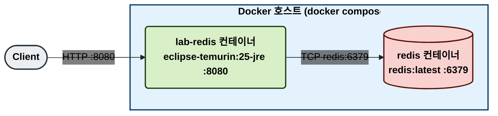
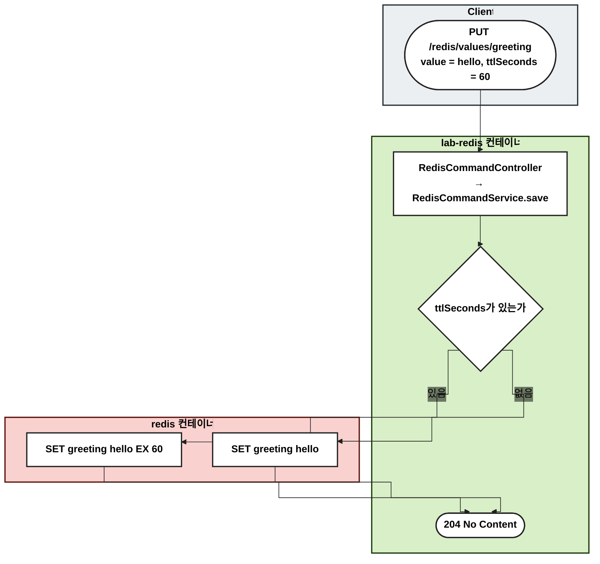
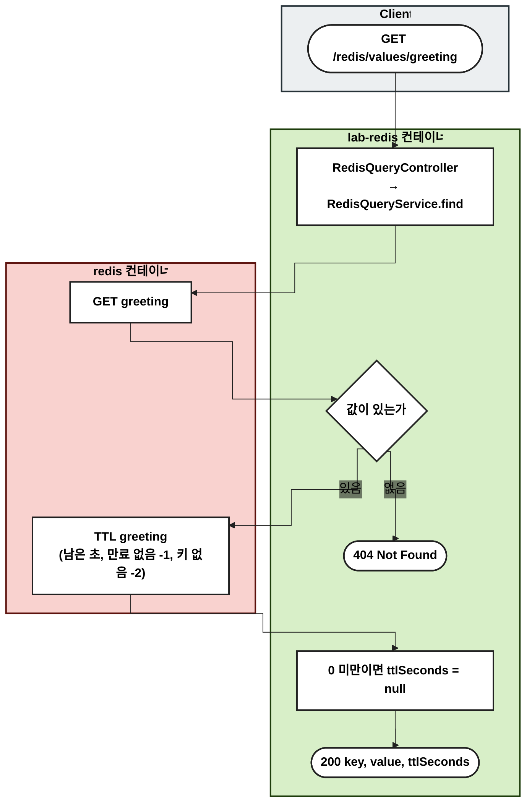
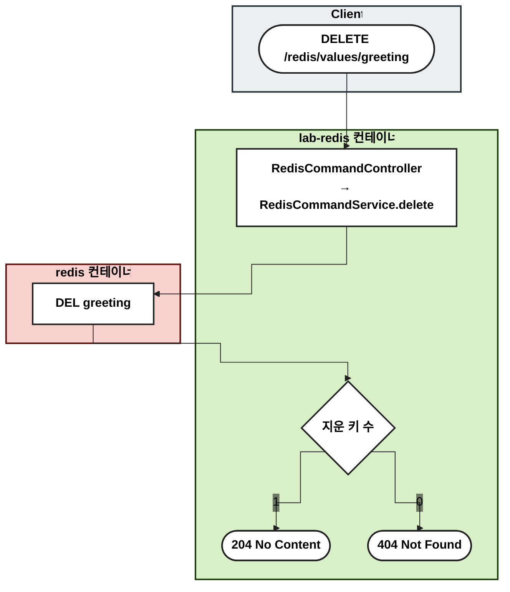
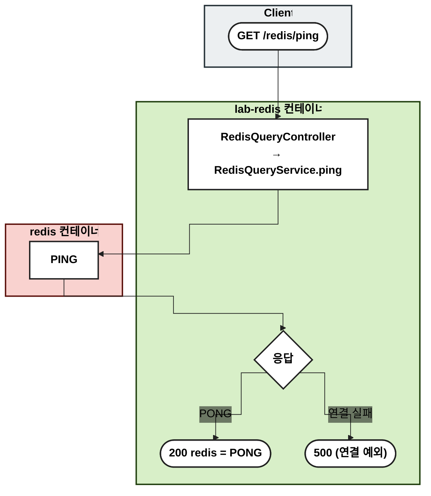

# base — Redis 기본 명령

Redis String 값의 저장·조회·삭제와 TTL, 연결 확인(PING)을 실습한다.

## 사용 기술

| 기술 | 쓰는 곳 |
| --- | --- |
| Redis String (`SET`, `GET`, `DEL`) | 값 저장·조회·삭제 |
| Redis 만료 (`SET ... EX`, `TTL`) | 만료 시간 설정과 남은 시간 조회 |
| `PING` | 연결 확인 |
| Spring Data Redis `StringRedisTemplate` + Lettuce | 애플리케이션에서 Redis 명령 실행 |

## 키 구조

| 키 | 타입 | 값 |
| --- | --- | --- |
| 요청 경로의 `{key}` 그대로 | String | 요청 본문의 `value` |

## 1. 물리 구성도

## 2. 흐름도

노드는 실행되는 서버별로 묶었다. Client(회색), lab-redis 컨테이너(초록), redis 컨테이너(빨강).

### 값 저장

### 값 조회

- `GET`과 `TTL`은 서로 다른 명령이라 그 사이에 키가 만료될 수 있다. 그러면 `TTL`이 -2를 돌려주고 응답의 `ttlSeconds`는 null이 된다.

### 값 삭제

### 연결 확인

- Redis는 명령을 하나씩 실행한다. 명령 하나는 원자적이지만, 명령 여러 개를 묶어 원자적으로 실행하지는 않는다.

## 검증하는 테스트

| 테스트 | 확인하는 것 |
| --- | --- |
| `base/repository/RedisCommandRepositoryTest` | `SET`(EX 포함), 덮어쓰기, `DEL` 결과 |
| `base/repository/RedisQueryRepositoryTest` | `GET`, `TTL`(-1, -2), `PING` |
| `base/RedisBaseFlowTest` | 저장 → 조회 → 삭제 → 404 흐름 |
