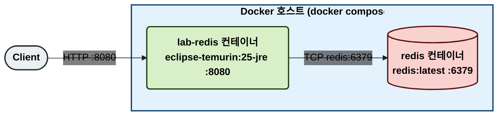
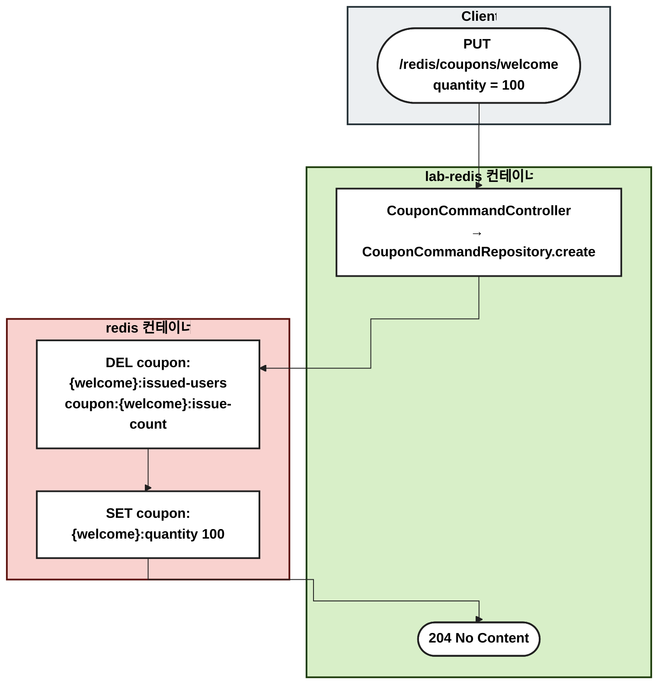
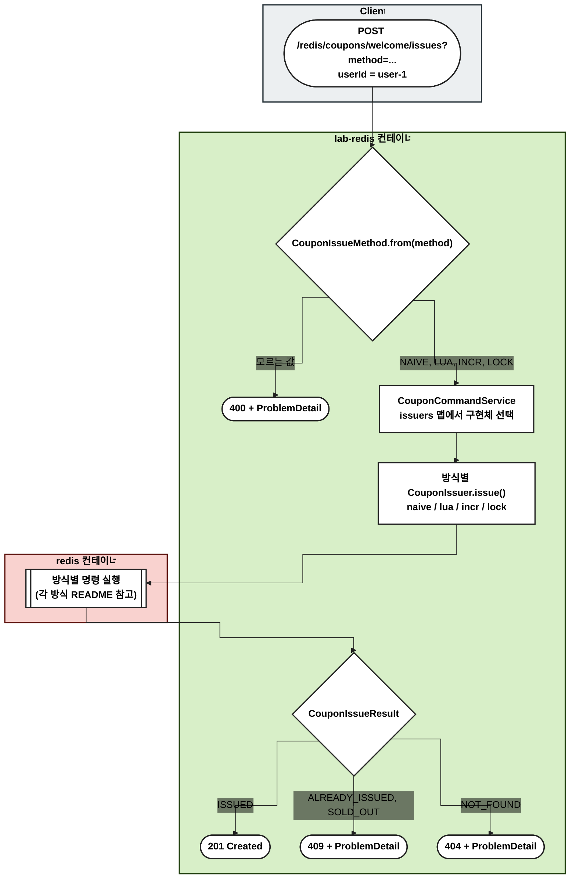
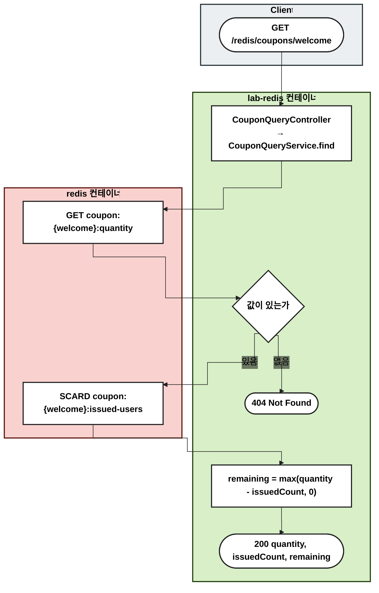

# couponfirstcome — 쿠폰 선착순 발급

정해진 수량의 쿠폰을 먼저 요청한 사용자에게만, 한 사람당 한 장씩 발급한다. 같은 요구사항을 네 가지 방식으로 구현해서 동시 요청에서 어떻게 다르게 동작하는지 비교한다.

## 지켜야 할 규칙

1. 발급 수는 등록한 수량을 넘지 않는다.
2. 한 사용자는 한 장만 받는다.
3. 동시에 요청이 몰려도 1, 2가 지켜진다.

## 방식 비교

| 방식 | 핵심 기술 | 규칙 3 (동시 요청) | 자세히 |
| --- | --- | --- | --- |
| `naive` | 명령 여러 개를 따로 실행 | 깨진다 (초과 발급) | [naive/README.md](naive/README.md) |
| `lua` | Lua 스크립트 (`EVALSHA`) | 지킨다 | [lua/README.md](lua/README.md) |
| `incr` | 원자 명령 `SADD`, `INCR` + 되돌리기 | 지킨다 (잠깐 Set이 커 보임) | [incr/README.md](incr/README.md) |
| `lock` | Redisson 분산 락 | 지킨다 (가장 느림) | [lock/README.md](lock/README.md) |

## 키 구조

모든 방식이 같은 키를 쓴다. 키 규칙은 `common/repository/CouponRedisKeys.kt` 한 곳에 있다.

| 키 | 타입 | 값 | 쓰는 방식 |
| --- | --- | --- | --- |
| `coupon:{couponId}:quantity` | String | 총 수량 | 전부 |
| `coupon:{couponId}:issued-users` | Set | 발급받은 사용자 ID | 전부 (조회 기준) |
| `coupon:{couponId}:issue-count` | String (정수) | 발급 순번 카운터 | `incr` |
| `coupon:{couponId}:issue-lock` | Hash (Redisson 락) | 락을 가진 클라이언트·스레드 | `lock` |

- `{couponId}`는 해시 태그다. 중괄호 안 문자열로 슬롯을 정하므로 같은 쿠폰의 키는 Redis Cluster에서도 한 노드에 모인다. 여러 키를 쓰는 Lua 스크립트를 실행하려면 이 조건이 필요하다.

## 1. 물리 구성도

## 2. 흐름도

등록, 발급, 조회의 공통 흐름이다. 노드는 실행되는 서버별로 묶었다: Client(회색), lab-redis 컨테이너(초록), redis 컨테이너(빨강). 발급의 방식별 Redis 명령은 각 방식 README의 흐름도에 있다.

### 쿠폰 등록

- 다시 등록하면 발급 기록과 순번을 지우고 처음부터 발급한다.

### 발급

### 조회

- 사용자별 발급 여부(`GET .../issues/{userId}`)는 `SISMEMBER coupon:{welcome}:issued-users user-1` 한 번으로 확인한다.

## 검증하는 테스트

| 테스트 | 확인하는 것 |
| --- | --- |
| `common/repository/CouponIssuerContractTest` | 규칙 1, 2를 순차 요청으로 (모든 방식이 상속) |
| `common/repository/ConcurrentCouponIssuerContractTest` | 규칙 3: 100명 동시 → 10장, 같은 사용자 50회 동시 → 1장 (`lua`, `incr`, `lock`이 상속) |
| `CouponFirstComeFlowTest` | 등록 → 발급 → 중복·소진 거절 → 조회 흐름을 네 방식 모두로 |
