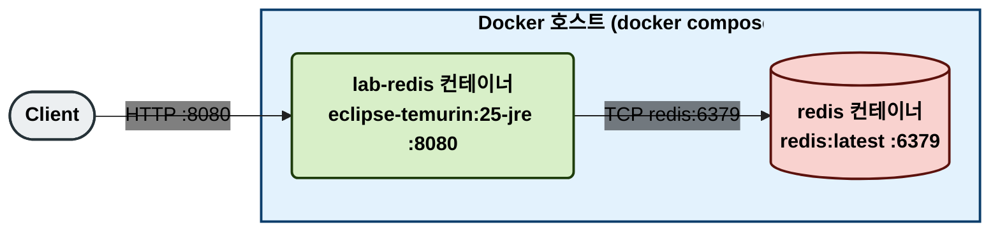
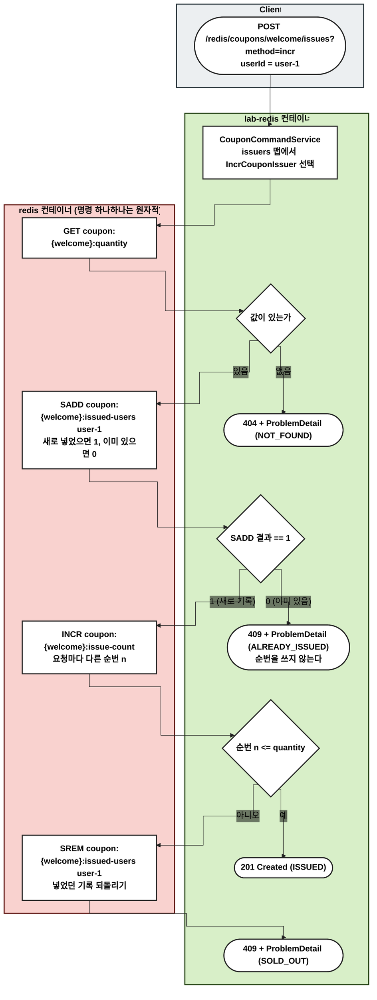
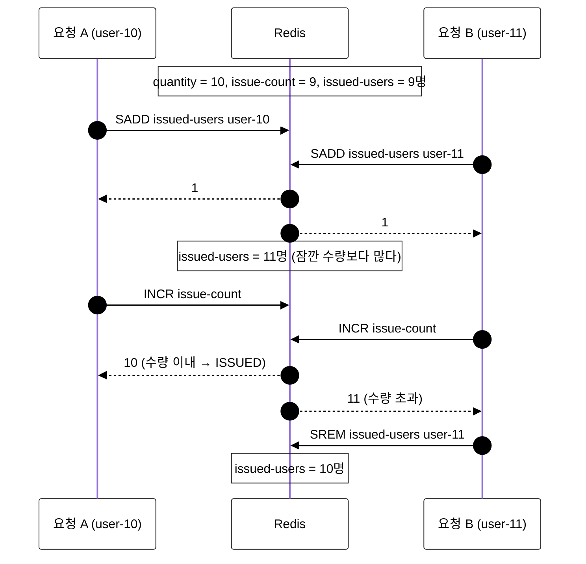

# incr — 원자 명령 결과로 판단하고 초과분은 되돌리기

스크립트나 락 없이, 원자적으로 실행되는 명령(`SADD`, `INCR`)의 반환값만 보고 판단한다. 먼저 기록하고 순번을 받은 뒤, 순번이 수량을 넘으면 기록을 되돌린다.

## 사용 기술

| 명령 | 역할 | 원자적으로 알려주는 것 |
| --- | --- | --- |
| `GET coupon:{id}:quantity` | 수량 확인 | 등록 여부 |
| `SADD coupon:{id}:issued-users <userId>` | 발급 기록 | 새로 넣었는지(1) 이미 있었는지(0) |
| `INCR coupon:{id}:issue-count` | 순번 받기 | 이 요청이 몇 번째인지 |
| `SREM coupon:{id}:issued-users <userId>` | 초과분 되돌리기 | |

naive와 달리 "확인한 값"이 아니라 "명령이 돌려준 결과"로 판단한다. 두 요청이 같은 순번을 받을 수 없으므로 수량을 넘겨 발급하지 않는다.

## 데이터 구조

| 키 | 타입 | 값 |
| --- | --- | --- |
| `coupon:{couponId}:quantity` | String | 총 수량 |
| `coupon:{couponId}:issued-users` | Set | 발급받은 사용자 ID (초과분은 SREM으로 되돌림) |
| `coupon:{couponId}:issue-count` | String (정수) | 발급 순번 카운터 |

## 1. 물리 구성도

## 2. 흐름도

노드는 실행되는 서버별로 묶었다. Client(회색), lab-redis 컨테이너(초록), redis 컨테이너(빨강).

- 판단의 근거는 `SADD`와 `INCR`의 반환값이다. 두 명령은 각각 원자적이라, 명령이 섞여 도착해도 같은 순번을 두 번 주지 않는다.
- 순번 카운터는 수량을 넘어서도 계속 올라간다. 쿠폰을 다시 등록하면 `CouponCommandRepository.create()`가 지운다.

## 3. 옵션: 동시 요청에서 지켜지는 이유

수량 10, 이미 9명 발급(순번 9)된 상태에서 두 사용자가 동시에 요청한 경우다. 두 요청의 명령이 섞이는 순서는 흐름도로 보기 어려워 시퀀스로 그린다.

- `INCR`은 원자적이라 두 요청이 같은 순번을 받지 않는다. 그래서 ISSUED는 수량만큼만 나온다.

## 한계와 주의할 점

- `SADD`와 `SREM` 사이에는 발급 Set에 수량보다 많은 사용자가 잠깐 보인다. 그 순간 조회하면 `issuedCount`가 수량보다 크게 나올 수 있다 (`remaining`은 0으로 맞춘다).
- 그 사이에 SOLD_OUT될 사용자가 다시 요청하면, 아직 Set에 남아 있어 ALREADY_ISSUED를 받을 수 있다.
- 되돌리기(`SREM`) 전에 애플리케이션이 죽으면 그 사용자는 발급된 것으로 남는다. lua 방식에는 이 문제가 없다.

## 검증하는 테스트

`incr/repository/IncrCouponIssuerTest`

- `ConcurrentCouponIssuerContractTest`를 상속한다.
- 순번이 수량을 넘으면 Set에서 되돌리고 순번은 남는지 확인한다.
- 중복 요청이 순번을 쓰지 않는지 확인한다.
