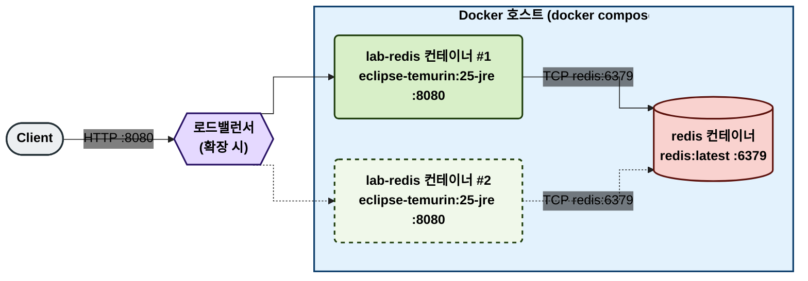
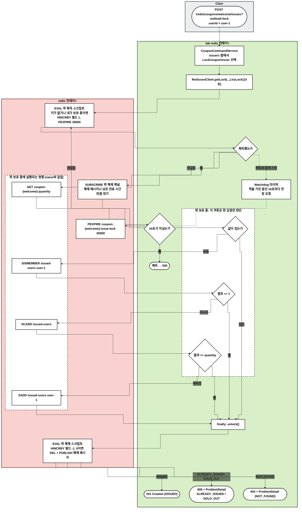
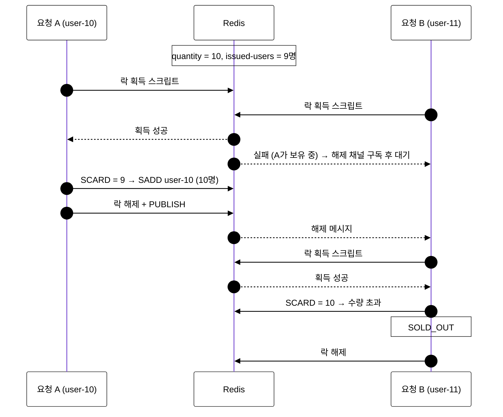

# lock — Redisson 분산 락

쿠폰마다 분산 락을 하나 두고, 락을 잡은 요청만 naive와 같은 확인 후 발급 로직을 실행한다. 한 번에 한 요청만 확인·발급하므로 경쟁 상태가 생기지 않는다. 대신 요청이 줄을 서서 다른 방식보다 느리다.

## 사용 기술

| 기술 | 역할 |
| --- | --- |
| Redisson `RLock` (`RedissonClient.getLock`) | 여러 애플리케이션 인스턴스 사이에서 동작하는 재진입 락 |
| 락 획득·해제 Lua 스크립트 (Redisson 내부) | 락 확인과 획득을 원자적으로 처리 |
| Redis Pub/Sub | 락이 풀리면 기다리던 요청에 알림 |
| Watchdog | 작업이 끝나기 전에 락이 만료되지 않게 자동 연장 |

- 설정: `lock/config/RedissonConfig.kt`. Spring의 `DataRedisConnectionDetails`로 접속하므로 Spring Data Redis와 같은 Redis에 붙는다.
- 아래 Redisson 내부 명령은 Redisson 소스 기준으로 요약한 것이다. 버전에 따라 세부가 다를 수 있다.

## 데이터 구조

| 키 | 타입 | 값 |
| --- | --- | --- |
| `coupon:{couponId}:quantity` | String | 총 수량 |
| `coupon:{couponId}:issued-users` | Set | 발급받은 사용자 ID |
| `coupon:{couponId}:issue-lock` | Hash (Redisson 락) | 필드 `(Redisson 클라이언트 ID):(스레드 ID)`, 값은 재진입 횟수. PEXPIRE 30초 |
| 락 해제 채널 (Redisson 내부) | Pub/Sub 채널 | 락 해제 알림 |

## 1. 물리 구성도

## 2. 흐름도

노드는 실행되는 서버별로 묶었다. Client(회색), lab-redis 컨테이너(초록), redis 컨테이너(빨강).

- 락이 Redis에 있으므로 앱 서버가 몇 대든 한 쿠폰의 발급은 한 번에 하나만 실행된다.
- 락 획득·해제·연장은 Redisson 연결로, 쿠폰 데이터 명령은 Spring Data Redis(Lettuce) 연결로 보낸다.

## 3. 옵션: 동시 요청에서 지켜지는 이유

수량 10, 이미 9명 발급된 상태에서 두 사용자가 동시에 요청한 경우다. 한 요청이 다른 요청을 기다리는 시간 순서는 흐름도로 보기 어려워 시퀀스로 그린다.

- naive와 명령은 같지만, 락 덕분에 A의 확인과 발급 사이에 B의 확인이 끼어들 수 없다.

## 부하 테스트

nGrinder 테스트 Parameter `method.lock`으로 실행한다. 실행 조건과 검증 기준은 [시나리오 README](../README.md)의 `부하 테스트` 섹션을 따른다.

예상 결과: 모두 통과. 응답 시간이 다른 방식보다 길다.

## 모니터링

| 도구 | 보는 곳 | 볼 것 |
| --- | --- | --- |
| Grafana | `redis / couponfirstcome` 대시보드 | `method="lock"` 선의 결과별 처리량과 p95 |
| Pinpoint | application `lab-redis` | Redisson 락 획득·해제 스크립트(`EVAL`)와 그 사이의 Lettuce 명령 4개가 보인다. 락 대기 시간도 구간으로 보인다 |

## 한계와 주의할 점

- 요청이 하나씩 줄을 서므로 처리량이 가장 낮다. 락 획득·해제 왕복과 대기가 요청마다 더해진다.
- 10초 안에 락을 얻지 못하면 예외가 나서 500으로 응답한다.
- 락은 단일 Redis 서버 기준이다. Redis가 장애로 넘어가는(failover) 순간에는 두 요청이 동시에 락을 잡을 수 있다.
- 락 하나가 쿠폰 하나의 모든 발급을 막으므로, 인기 쿠폰일수록 대기가 길어진다.

## 검증하는 테스트

`lock/repository/LockCouponIssuerTest`

- `ConcurrentCouponIssuerContractTest`를 상속한다.
- 발급이 끝나면 락 키가 남지 않는지 확인한다.
