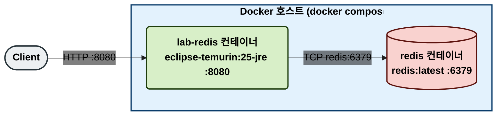
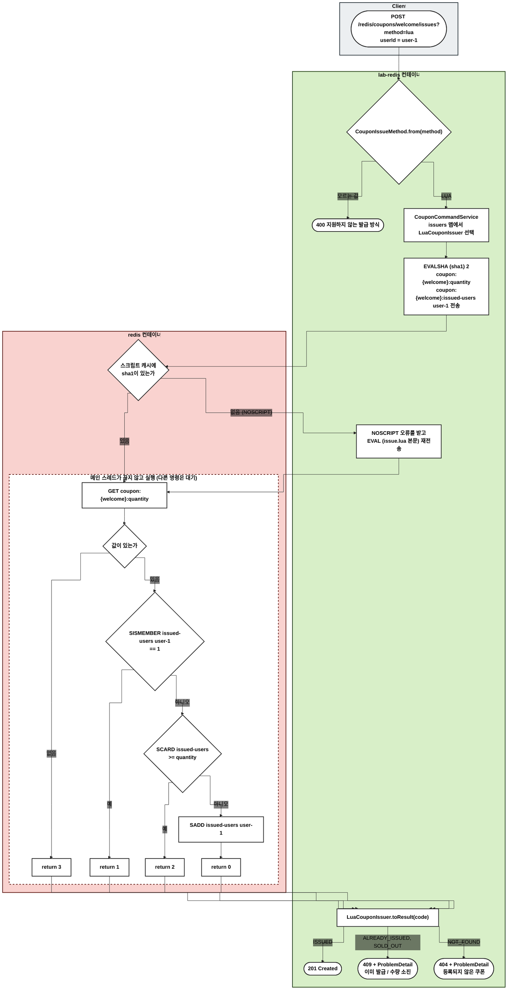
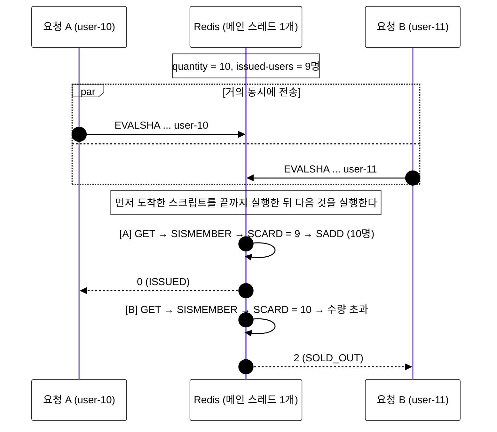

# lua — Lua 스크립트로 원자적 발급

수량 확인, 중복 확인, 발급을 Lua 스크립트 하나로 Redis 안에서 실행한다. Redis는 스크립트를 실행하는 동안 다른 명령을 처리하지 않으므로, 확인과 발급 사이에 다른 요청이 끼어들 수 없다.

## 사용 기술

| 기술 | 역할 |
| --- | --- |
| Redis Lua 스크립트 (`EVAL`, `EVALSHA`) | 명령 여러 개를 원자적으로 실행 |
| 스크립트 캐시 (SHA1) | 스크립트 본문 대신 해시만 보내 네트워크 비용을 줄임 |
| Spring Data Redis `RedisScript` | 스크립트 로드, SHA1 계산, `EVALSHA` → `EVAL` 대체 실행 |

- 스크립트: `src/main/resources/redis/couponfirstcome/lua/issue.lua`
- 호출: `LuaCouponIssuer.issue()` → `StringRedisTemplate.execute(issueScript, keys, userId)`

## 데이터 구조

| 키 | 타입 | 값 |
| --- | --- | --- |
| `coupon:{couponId}:quantity` | String | 총 수량 |
| `coupon:{couponId}:issued-users` | Set | 발급받은 사용자 ID |

스크립트 입력과 반환:

| 구분 | 값 |
| --- | --- |
| `KEYS[1]` | `coupon:{couponId}:quantity` |
| `KEYS[2]` | `coupon:{couponId}:issued-users` |
| `ARGV[1]` | 사용자 ID |
| 반환 0 | ISSUED |
| 반환 1 | ALREADY_ISSUED |
| 반환 2 | SOLD_OUT |
| 반환 3 | NOT_FOUND |

## 1. 물리 구성도

## 2. 흐름도

노드는 실행되는 서버별로 묶었다. Client(회색), lab-redis 컨테이너(초록), redis 컨테이너(빨강).

- 요청 하나는 Redis와 한 번만 왕복한다 (`EVALSHA`, 캐시에 없을 때만 `EVAL` 한 번 더).
- 앱 서버를 여러 대로 늘려도 스크립트는 같은 Redis에서 하나씩 실행되므로 규칙이 지켜진다.

## 3. 옵션: 동시 요청에서 지켜지는 이유

수량 10, 이미 9명 발급된 상태에서 두 사용자가 동시에 요청한 경우다. 두 요청이 겹치는 시간 순서는 흐름도로 보기 어려워 시퀀스로 그린다.

- 확인과 발급이 한 덩어리로 실행되므로 naive의 check-then-act 경쟁 상태가 생기지 않는다.

## 부하 테스트

nGrinder 테스트 Parameter `method.lua`로 실행한다. 실행 조건과 검증 기준은 [시나리오 README](../README.md)의 `부하 테스트` 섹션을 따른다.

예상 결과: 모두 통과.

## 모니터링

| 도구 | 보는 곳 | 볼 것 |
| --- | --- | --- |
| Grafana | `redis / couponfirstcome` 대시보드 | `method="lua"` 선의 결과별 처리량과 p95 |
| Pinpoint | application `lab-redis` | Redis 명령이 `EVALSHA` 하나로 보인다 |

## 한계와 주의할 점

- 스크립트가 오래 걸리면 그동안 Redis 전체가 멈춘다. 스크립트에는 짧은 명령만 넣는다.
- 스크립트가 쓰는 키는 모두 `KEYS`로 넘긴다. 그래야 Redis Cluster가 키의 슬롯을 확인할 수 있다. 이 시나리오는 `{couponId}` 해시 태그로 두 키를 같은 슬롯에 둔다.
- 스크립트 중간에 오류가 나면 그 전에 실행한 쓰기는 되돌려지지 않는다. 이 스크립트는 마지막에 쓰기(`SADD`) 하나만 하므로 문제가 없다.

## 검증하는 테스트

`lua/repository/LuaCouponIssuerTest`: `ConcurrentCouponIssuerContractTest`를 상속한다 (순차 규칙 + 100명 동시 → 10장 + 같은 사용자 50회 동시 → 1장).
