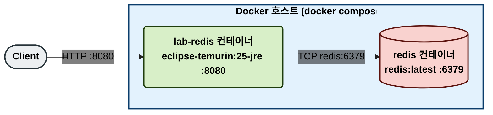
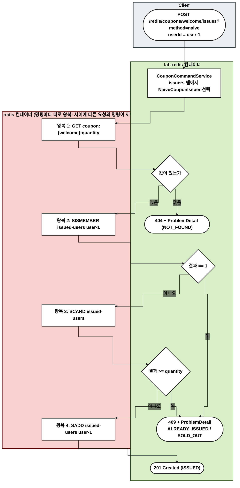
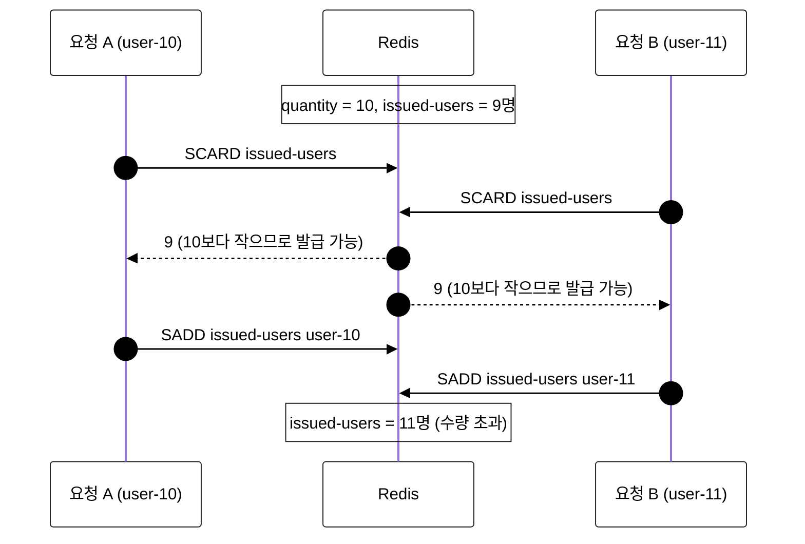

# naive — 확인 후 발급 (비교 기준선)

수량과 중복을 명령으로 하나씩 확인한 뒤 발급한다. 순차 요청에서는 맞게 동작하지만, 동시 요청에서는 초과 발급된다. 다른 방식과 비교하려고 일부러 남겨 둔 잘못된 구현이다.

## 사용 기술

| 명령 | 역할 |
| --- | --- |
| `GET coupon:{id}:quantity` | 수량 확인 |
| `SISMEMBER coupon:{id}:issued-users <userId>` | 중복 확인 |
| `SCARD coupon:{id}:issued-users` | 발급 수 확인 |
| `SADD coupon:{id}:issued-users <userId>` | 발급 기록 |

명령 하나하나는 원자적이지만, 네 명령을 묶어 주는 장치가 없다.

## 데이터 구조

| 키 | 타입 | 값 |
| --- | --- | --- |
| `coupon:{couponId}:quantity` | String | 총 수량 |
| `coupon:{couponId}:issued-users` | Set | 발급받은 사용자 ID |

## 1. 물리 구성도

## 2. 흐름도

노드는 실행되는 서버별로 묶었다. Client(회색), lab-redis 컨테이너(초록), redis 컨테이너(빨강).

- 판단(초록)은 앱에서, 명령(빨강)은 Redis에서 실행되므로 요청 하나가 Redis와 4번 오간다. 동시 요청이면 여러 요청의 명령이 섞여 Redis에 도착한다.

## 3. 옵션: 동시 요청에서 깨지는 이유

수량 10, 이미 9명 발급된 상태에서 두 사용자가 동시에 요청한 경우다. 두 요청의 명령이 섞이는 순서는 흐름도로 보기 어려워 시퀀스로 그린다.

- 확인(`SCARD`)과 발급(`SADD`) 사이에 다른 요청의 확인이 끼어들어, 둘 다 "남아 있다"고 판단한다. 이것을 check-then-act 경쟁 상태라고 한다.
- 같은 사용자가 동시에 요청하면 둘 다 `SISMEMBER`에서 0을 받는다. `SADD`는 Set이라 한 번만 들어가지만, 두 요청 모두 ISSUED로 응답한다.

## 부하 테스트

nGrinder 테스트 Parameter `method.naive`로 실행한다 (비워도 naive다). 실행 조건과 검증 기준은 [시나리오 README](../README.md)의 `부하 테스트` 섹션을 따른다.

예상 결과: 검증 실패. 초과 발급되고, 201 응답 수가 실제 발급 수보다 많다.

## 모니터링

| 도구 | 보는 곳 | 볼 것 |
| --- | --- | --- |
| Grafana | `redis / couponfirstcome` 대시보드 | `method="naive"` 선의 결과별 처리량과 p95 |
| Pinpoint | application `lab-redis` | Redis 명령 4개(`GET`, `SISMEMBER`, `SCARD`, `SADD`)가 따로 보인다 |

## 검증하는 테스트

`naive/repository/NaiveCouponIssuerTest`

- `CouponIssuerContractTest`를 상속해서 순차 규칙은 통과하는 것을 확인한다.
- 100명이 동시에 요청하면 ISSUED가 10을 넘는 것을 확인한다. 경쟁 상태를 재현하는 테스트라 드물게 초과 발급이 안 나올 수 있다.
